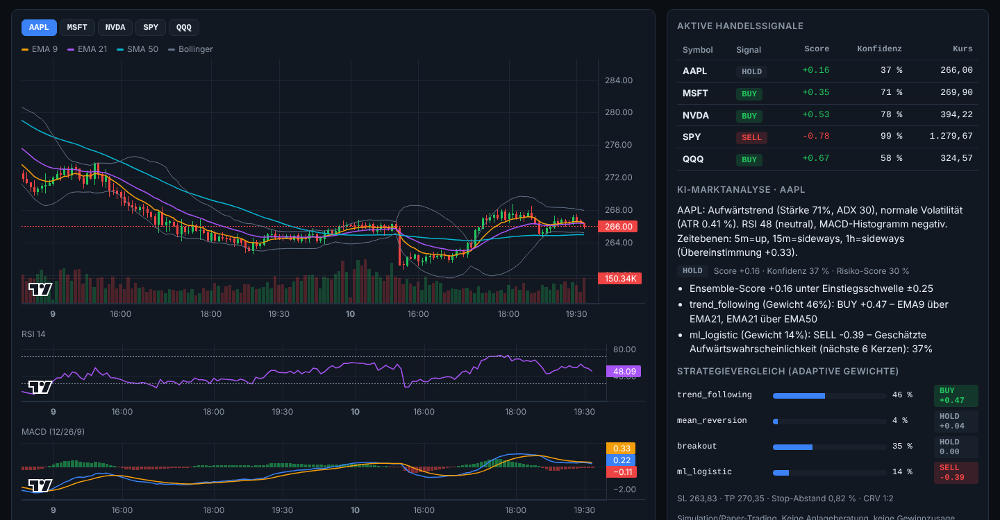

# AI Day Trading System (nur Paper-Trading)

Ein autonomes, modular aufgebautes KI-Day-Trading-System für **Aktien und ETFs**. Es analysiert
Marktdaten fortlaufend, vergleicht mehrere Strategien, trifft nachvollziehbar begründete
Entscheidungen und handelt **ausschließlich simuliert mit virtuellem Kapital**.

> **Wichtig:** Dieses System führt **keine Echtgeldtransaktionen** aus. Es enthält keinen Code,
> der Orders an einen Broker sendet, aktiviert keine Broker-Handelsrechte und bewegt kein Kapital.
> Eine andere Betriebsart als `paper` bricht beim Start hart ab. Die Ergebnisse sind keine
> Anlageberatung und keine Gewinnzusage.



## Funktionen

| Bereich | Umsetzung |
|---|---|
| Marktdaten | Alpaca (Echtzeit, IEX), Alpha Vantage, Yahoo (verzögert), Fallback-Kette mit Cache und Circuit-Breaker, Offline-Simulator |
| Indikatoren | RSI (Wilder), MACD, EMA, SMA, Bollinger Bands, ATR, ADX, VWAP, realisierte Volatilität, z-Scores |
| Marktanalyse | Trend- und Trendstärke-Erkennung, Volatilitätsregime, Multi-Timeframe (5m / 15m / 1h), Anomalien (Preisschock, Volumenspitze, Gap, Volatilitätsausbruch) |
| Strategien | Trendfolge, Mean-Reversion, Breakout, walk-forward-trainierte logistische Regression (ML) |
| KI-Engine | Adaptive Ensemble-Gewichtung nach gemessener Vorhersagekraft (Information Coefficient), Konfidenz- und Risikobewertung, begründete BUY/SELL/HOLD-Entscheidung, JSONL-Entscheidungsjournal, optionaler Claude-Kommentar |
| Paper-Trading | Simulierte Marktorders, Stop-Loss/Take-Profit (inkl. Gap-Behandlung), Positionsgrößen nach Fixed-Fractional/ATR, Gebühren und Slippage, Kill-Switches (Tagesverlust, Drawdown) |
| Protokoll | SQLite: Transaktionen, abgeschlossene Trades, Equity-Kurve, Zustand (übersteht Neustarts) |
| Dashboard | Live-Charts (Kerzen, EMA, Bollinger, RSI, MACD, Kauf-/Verkaufsmarker, SL/TP-Linien), Portfolio, G/V-Statistik, Signale, KI-Analyse, Transaktionen, Risikokennzahlen |
| Backtest | Gleiche Engine und gleicher Broker, Ausführung zum Open der Folgekerze, Strategievergleich gegen Buy & Hold |
| Qualität | 52 automatische Tests, verschlüsselter Schlüsseltresor, Fehlerisolation je Symbol/Strategie, GitHub-Actions-CI |

## Schnellstart

```bash
cd ai-trading
```

```bash
pip install -r requirements.txt
```

```bash
python -m trading_system serve --autostart
```

Danach <http://127.0.0.1:8000> öffnen. Ohne Zugangsdaten nutzt das System Yahoo (verzögert) und,
falls nicht erreichbar, den **Simulator** – das Dashboard zeigt dann deutlich „Daten: SIMULIERT“.

Weitere Befehle:

```bash
python -m trading_system status            # Konfiguration + fehlende Zugangsdaten
```

```bash
python -m trading_system analyze NVDA      # Analyse und begründete KI-Entscheidung
```

```bash
python -m trading_system step              # genau ein Handelszyklus
```

```bash
python -m trading_system run               # autonomer Betrieb ohne Oberfläche
```

```bash
python -m trading_system compare --bars 2000   # Strategievergleich per Backtest
```

```bash
python -m trading_system vault set ALPACA_API_KEY   # Schlüssel verschlüsselt speichern
```

```bash
python -m pytest -q                        # Tests
```

## Dokumentation

- [docs/SETUP.md](docs/SETUP.md) – Integrationen, Zugangsdaten, manuelle Schritte
- [docs/ARCHITECTURE.md](docs/ARCHITECTURE.md) – Aufbau, Datenfluss, Entscheidungslogik, Erweiterung

## Haftungsausschluss

Handel mit Wertpapieren ist mit erheblichen Risiken verbunden. Backtests und Paper-Trading-Ergebnisse
sind keine Prognose zukünftiger Erträge, insbesondere nicht auf simulierten Daten. Dieses Projekt dient
Lern- und Forschungszwecken.
